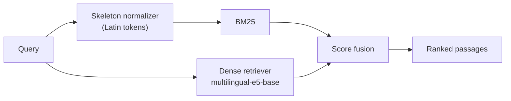

<div align="center">

# Bengali Code-Mixed Retrieval

**A benchmark and hybrid retrieval framework for Bangla-script, code-mixed and Romanized Bengali queries**


[Overview](#overview) •
[Results](#results) •
[Getting Started](#getting-started) •
[Dataset](#dataset) •
[Reproducibility](#reproducibility) •
[Roadmap](#roadmap) •
[Citation](#citation)

</div>

---

## Overview

Bengali speakers write the same question in several ways: in Bangla script, mixed with English, or Romanized (Bengali typed in Latin letters). Retrieval systems are mostly built and tested on single-script text, so it is unclear how well they serve the other forms.

This project provides:

- **A passage-retrieval benchmark** with 10,264 queries over 99,567 Bengali Wikipedia passages.
- **A parallel subset** of 1,147 questions, each written in all three forms, to isolate the effect of the writing form.
- **Baselines** for sparse (BM25), dense (multilingual E5) and hybrid retrieval.
- **A training-free normalizer** that helps lexical search match Romanized queries against Bangla text.
- **An evaluation pipeline** with paired bootstrap confidence intervals.

### The three query forms

*"In which year's NBA draft did the Lakers pick Magic Johnson?"*

| Form | `script` value | Query |
|---|---|---|
| Bangla script | `bangla` | লেকার্স ম্যাজিক জনসনকে কোন সালের এনবিএ ড্রাফটে বেছে নিয়েছিল? |
| Code-mixed | `mixed` | Lakers ম্যাজিক জনসনকে কোন সালের NBA draft-এ select করেছিল? |
| Romanized | `romanized` | Lakers Magic Johnsonke kon sheler NBA draft e beche niyechilo? |

### Retrieval pipeline



| Component | Description |
|---|---|
| **BM25** | `bm25s` over lower-cased tokens, without stemming. |
| **Dense retriever** | `intfloat/multilingual-e5-base` with cosine similarity. |
| **Skeleton normalizer** | Reduces each Bangla word in the corpus to a consonant skeleton, then expands each Latin query token with the 3 most frequent words sharing its skeleton. The original token is kept. No training data or relevance labels are needed. |
| **Fusion** | Reciprocal rank fusion, or a weighted sum of min-max normalized scores. Tuned weights are chosen on training queries only. |

## Results

nDCG@10 on the parallel test split (165 questions × 3 forms = 495 queries). Higher is better.

| System | Bangla | Mixed | Romanized | All |
|---|:---:|:---:|:---:|:---:|
| BM25 | 0.575 | 0.348 | 0.014 | 0.312 |
| Dense (E5) | 0.708 | 0.659 | 0.137 | 0.501 |
| Hybrid (dense weight 0.7) | 0.736 | 0.622 | 0.079 | 0.479 |
| Hybrid 0.7 + normalizer | 0.737 | 0.651 | **0.248** | 0.545 |
| Hybrid, single tuned weight (0.8) + normalizer | **0.752** | **0.690** | 0.238 | **0.560** |
| Hybrid, per-script weights + normalizer | **0.752** | **0.690** | 0.233 | 0.558 |

### Key findings

Intervals are 95% paired bootstrap confidence intervals.

1. **Writing form strongly affects retrieval.** On identical questions, quality drops from Bangla script to code-mixed to Romanized. BM25 almost fails on Romanized queries.
2. **Dense retrieval narrows the code-mixed gap but not the Romanized gap.**
3. **The normalizer recovers part of the Romanized loss.** It raises the 0.7 hybrid from 0.079 to 0.248 (+0.169, CI [+0.119, +0.221]).
4. **Adapting the fusion weight to the script gives no measurable gain** over one tuned weight (-0.002, CI [-0.017, +0.014]).

Per-query ranks and complete tables are in [`corpus_md_build/data/release_eval/`](corpus_md_build/data/release_eval/).

## Getting Started

### Prerequisites

- Python 3.12
- Git
- Optional: an Apple Silicon machine. The evaluation scripts use `mps` when available and otherwise run on the CPU, which is much slower for encoding.

### Installation

```bash
git clone https://github.com/montaahaaa/bengali-codemixed-hybrid-retrieval.git
cd bengali-codemixed-hybrid-retrieval

python3.12 -m venv .venv
source .venv/bin/activate

pip install -r requirements.txt
pip install bm25s==0.3.16 tqdm
```

Verify the installation (this downloads a model on first run):

```bash
python scripts/check_setup.py
```

### Configuration

API keys are needed **only to generate new queries**. Evaluation needs none.

```bash
cp .env.example .env    # then fill in the keys; never commit this file
pip install anthropic   # only for query generation
```

| Variable | Used for |
|---|---|
| `ANTHROPIC_API_KEY` | Query generation with Claude |
| `GROQ_API_KEY` | Query generation through Groq |

### Quick start

Load the parallel test queries and their relevance labels:

```python
import pandas as pd

queries = pd.read_csv("submission/queries.csv")
qrels = pd.read_csv("submission/qrels.csv")

data = queries.merge(qrels, on="query_id")
test = data[(data["split"] == "test") & data["query_id"].str.startswith("P")]

print(test["script"].value_counts())   # 165 queries per form
```

## Dataset

| File | Rows | Columns |
|---|---:|---|
| [`submission/queries.csv`](submission/queries.csv) | 10,264 | `query_id`, `query`, `script`, `domain`, `split` |
| [`submission/qrels.csv`](submission/qrels.csv) | 10,264 | `query_id`, `passage_id`, `relevance` |
| `submission/corpus.csv` | 99,567 | `passage_id`, `title`, `text`, `source_url` |

> [!IMPORTANT]
> `corpus.csv` (about 169 MB) is **not included** in this repository. Contact the maintainers to obtain it.

### Subsets

The first letter of `query_id` identifies the subset.

| Subset | Queries | Description |
|---|---:|---|
| `P` (parallel) | 3,441 | The same question in all three forms for 1,147 passages. IDs end in `_b`, `_m` or `_r`. |
| `G` (non-parallel) | 6,823 | The three forms of a passage usually ask different questions. |

Use the `P` subset for any claim about the effect of the writing form.

### Splits

| Train | Dev | Test |
|---:|---:|---:|
| 7,246 | 1,564 | 1,454 |

Splits are assigned by passage, so no passage appears in more than one split.

### Construction

1. **Corpus:** Bengali Wikipedia ([`sagorsarker/bangla-wikipedia`](https://huggingface.co/datasets/sagorsarker/bangla-wikipedia), snapshot 20250620), split on sentence boundaries into passages of mostly 80 to 300 words.
2. **Queries:** generated by language models from one passage each.
3. **Filtering:** automatic answerability, script and duplicate checks.
4. **Labels:** one relevant passage per query.

`script` is derived from characters, not language: an English word written in Bangla script counts as `bangla`.

See the [data card](submission/README.md) for more detail. Its baseline figures come from an earlier run and are superseded by the [Results](#results) above.

## Reproducibility

Evaluation needs the following files, which are too large for the repository:

| File | Source |
|---|---|
| `corpus_md_build/data/corpus.jsonl` | Working corpus (100,000 passages), from the maintainers |
| `submission/corpus.csv` | Generated by `26_build_submission.py` |
| `corpus_md_build/data/emb_e5base_passages.npy` | Generated by `07_encode_e5.py` |

With `corpus.jsonl` in place:

```bash
cd corpus_md_build

python 26_build_submission.py      # build the release files
python 07_encode_e5.py             # encode the passages
python 29_eval_release.py .. data/release_eval/release_eval.json
python 30_cluster_bootstrap.py data/release_eval ..
python 31_derived_tables.py data/release_eval ..
python 32_check_release.py ..      # check dataset statistics
```

> [!WARNING]
> These commands overwrite the tracked files in `submission/` and `corpus_md_build/data/release_eval/`.

> [!NOTE]
> The exact corpus cannot currently be rebuilt from a fresh clone. The working corpus contains 433 government-website passages that are excluded from the release because the sites state no open license. Rebuilding without them changes the passage IDs, which then no longer match `qrels.csv`.

## Project Structure

```text
.
├── corpus_md_build/        # Benchmark pipeline and its data
├── submission/             # Released queries, labels and data card
├── review/                 # Human review sheets and flagged queries
├── scripts/                # Setup check and pilot-stage scripts
├── data/                   # Pilot annotations and corpus card
├── experiments/            # Pilot results and experiment tracker
├── dataset/                # Earlier template-generated query set
├── notebooks/              # Exploratory notebooks
├── paper/                  # LaTeX drafts
├── corpus.md               # Early corpus build notes
├── research_proposal.md    # Original research plan
└── requirements.txt        # Python dependencies
```

Main scripts in `corpus_md_build/`:

| Scripts | Stage |
|---|---|
| `01`–`03` | Collect Wikipedia and web text, build the corpus |
| `12`, `13` | Generate and filter non-parallel queries |
| `21`, `21b`, `22`, `25` | Generate and clean parallel queries |
| `15`, `17`, `19`, `20`, `27`, `28` | Human review, corrections and flags |
| `26` | Build the release files |
| `29`–`32` | Evaluate and verify the release |

Other numbered scripts are earlier iterations or side analyses.

## Limitations

Please consider these before using the benchmark or citing the results.

- Queries are model-generated and **mostly not reviewed by humans**. They are likely cleaner than real user queries.
- In a review of 34 parallel passages by one reviewer, 9 had a question that did not name its subject, so several passages could answer it.
- Each query has a single labeled passage. Other correct passages count as wrong, so scores are lower bounds.
- The corpus is encyclopedic and small, with little text on everyday services.
- Only one dense model has been evaluated.
- The test split was already scored in earlier analyses and is not a fresh held-out set.

## Roadmap

- [x] Build the corpus and benchmark
- [x] Evaluate BM25, dense and hybrid baselines
- [x] Evaluate the Romanized skeleton normalizer
- [x] Compare single and per-script fusion weights
- [ ] Review queries with two independent reviewers
- [ ] Collect queries written by native speakers
- [ ] Add more dense models, transliteration baselines and a reranker
- [ ] Add pooled, graded relevance judgments
- [ ] Add a code-mixing index and language-level tagging
- [ ] Evaluate end-to-end retrieval-augmented generation (RAG)

The original plan is described in the [research proposal](research_proposal.md).

## Contributing

Contributions and corrections are welcome, especially fixes to queries.

1. Open an [issue](https://github.com/montaahaaa/bengali-codemixed-hybrid-retrieval/issues) describing the change.
2. Fork the repository and create a feature branch.
3. Submit a pull request that explains what changed and how you checked it.

Never commit API keys or the `.env` file.

## Citation

If you use this benchmark or code, please cite the repository:

```bibtex
@misc{bengali_codemixed_retrieval_2026,
  author       = {montaahaaa},
  title        = {A Benchmark and Hybrid Retrieval Framework for Bengali Code-Mixed Queries},
  year         = {2026},
  howpublished = {\url{https://github.com/montaahaaa/bengali-codemixed-hybrid-retrieval}}
}
```

## License

- **Passage text** comes from Wikipedia and is licensed under [CC BY-SA 4.0](https://creativecommons.org/licenses/by-sa/4.0/). Keep `title` and `source_url` for attribution, and share adaptations under the same license.
- **Code, queries and relevance labels** do not yet have a license. Until one is added, please contact the maintainers before reusing or redistributing them.

## Acknowledgements

- [Bengali Wikipedia](https://bn.wikipedia.org/) contributors
- The [`sagorsarker/bangla-wikipedia`](https://huggingface.co/datasets/sagorsarker/bangla-wikipedia) dataset
- [multilingual E5](https://huggingface.co/intfloat/multilingual-e5-base), [`bm25s`](https://github.com/xhluca/bm25s) and [Sentence Transformers](https://www.sbert.net/)
